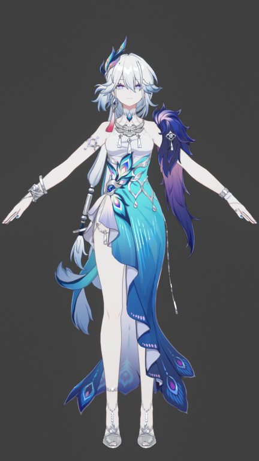
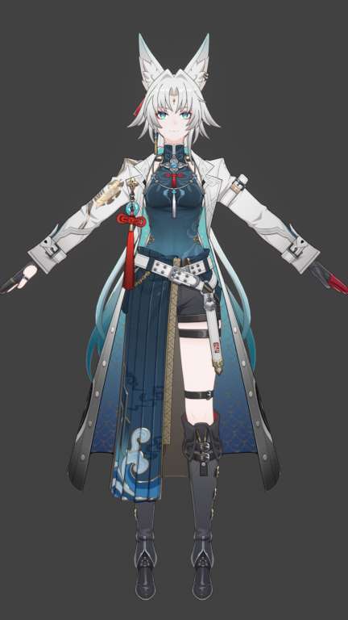
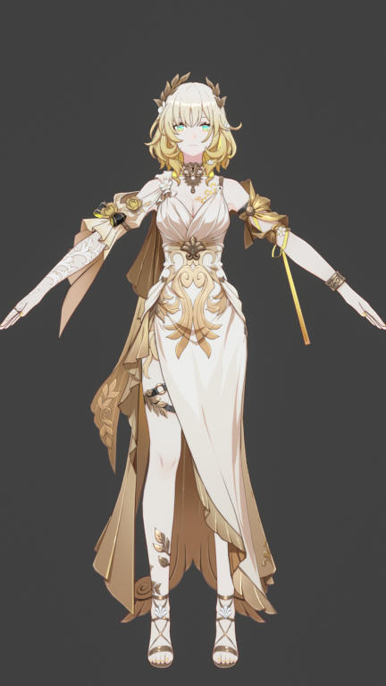
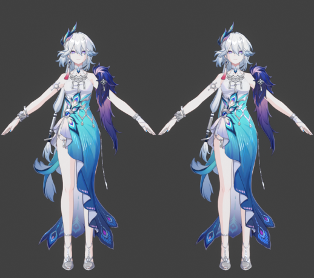
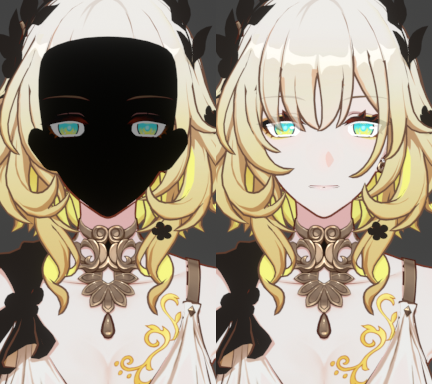

# StellarToon MMD

一个 Blender 插件：按《崩坏：星穹铁道》游戏材质 JSON 里的参数，给 MMD（PMX）模型一键挂上 [StellarToon](https://github.com/festivities/Blender-StellarToon) 渲染。

StellarToon 是给游戏解包模型做的着色器，直接给 MMD 模型用需要手动做很多事：按材质拆网格、逐个材质换节点、照 JSON 抄几十个参数、放头部空物体、挂几何节点、调渲染设置。这个插件把这些步骤做成了一个面板。

| 爻光 | 飞霄 | 阿格莱雅 |
|:---:|:---:|:---:|
|  |  |  |

上图是插件自动处理后的 Goo Engine 4.4 渲染结果，没有手动调整。

> **插件不附带任何模板、着色器文件或游戏资源。** StellarToon 模板、游戏材质 JSON、游戏贴图、MMD 模型都需要你自己准备，并且确认你有权使用。

---

## 目录

- [它做了什么](#它做了什么)
- [准备工作](#准备工作)
- [安装](#安装)
- [使用步骤](#使用步骤)
- [面板选项说明](#面板选项说明)
- [主光方向与跟随灯光](#主光方向与跟随灯光)
- [常见问题](#常见问题)
- [已知限制](#已知限制)
- [Body_D 和 Body_S 的区别](#body_d-和-body_s-的区别)
- [升级插件](#升级插件)
- [开发与打包](#开发与打包)
- [致谢](#致谢)
- [许可证](#许可证)

---

## 它做了什么

点一次「应用 StellarToon」，插件依次完成：

1. **按材质拆分网格**：调用 mmd_tools 的「按材质分开」，每个 MMD 材质变成一个物体（`000_顏`、`00C_裙擺` 这样的名字），之后可以单独调试。
2. **从你的模板里追加 StellarToon 材质和几何节点**（只追加一次），并按角色复制一份，不会改动模板本身。
3. **填贴图**：主贴图、Lightmap、暖/冷 Ramp、丝袜贴图、面部阴影图（FaceMap）按 JSON 里记录的文件名自动找到并填进对应节点，色彩空间和插值方式一起设好。
4. **填参数**：高光颜色/锐度/粗糙度/强度（8 组材质 ID）、边缘光、丝袜、自发光、脸部阴影颜色、鼻线、描边颜色等，按 JSON 自动填写。字段对应关系参考了 Character Setup Wizard，并按手调工程的数值做了校正。
5. **头部空物体**：`Head Origin`（用「子级」约束挂到头部骨骼上）、`Head Forward`、`Head Up`，脸部阴影靠它们判断头的朝向。
6. **创建主光方向**：一个场景共用的 `Main Light Direction` 空物体，可以绑定到场景灯光。
7. **挂修改器**：每个物体按 `骨架 → Light Vectors → StellarToon - Outlines GN` 的顺序挂几何节点。眼睛、牙齿、舌头这类部位不加描边。
8. **背面剔除**：和 MMD 原材质保持一致。MMD 里标记为双面的材质会单独生成一份「(双面)」版本。
9. **修正渲染设置**：渲染器切到 Goo Engine，打开屏幕空间反射和折射，色彩管理改为 Standard。

材质匹配是自动的：插件把 MMD 材质的主贴图和游戏 JSON 的 `_MainTex` 缩成小图逐像素比较，再结合名字（脸、头发）判断。匹配结果显示在列表里，可以逐行手动改。

---

## 准备工作

| 需要 | 说明 |
|---|---|
| **Goo Engine** | StellarToon 依赖 Goo Engine 独有的节点（屏幕空间信息、曲率边缘光等），普通 Blender 渲染不出正确效果。已测试 Goo Engine **3.6** 和 **4.4**。下载：[dillongoostudios/goo-engine](https://github.com/dillongoostudios/goo-engine) |
| **mmd_tools** | 用来导入 PMX 和按材质拆分。Blender 4.2+ 从扩展平台安装，3.6 用旧版插件。[MMD-Blender/blender_mmd_tools](https://github.com/MMD-Blender/blender_mmd_tools) |
| **StellarToon 模板 .blend** | 包含 StellarToon 材质和节点组的 .blend 文件，例如 HoyoToon-Assets 里的 `StellarToon-MMD-fix.blend`。要求见下方。 |
| **角色资源文件夹** | 某个角色的游戏材质 JSON 和贴图，结构如下。 |
| **面部阴影贴图文件夹**（推荐） | 通用的 `W_170_Lady_FaceMap_00.png`、`M_180_Male_FaceMap_00.png` 等。很多角色文件夹里没有自带这张图。 |
| **MMD 模型** | 星穹铁道角色的 PMX 模型，贴图需要是游戏原版 UV 的（大部分官方/解包改的 MMD 模型都是）。 |

### 模板 .blend 的要求

插件会检查模板里有没有下面这些数据块，缺了会在偏好设置里提示：

- 材质：`StellarToon - Base`、`StellarToon - Hair`、`StellarToon - Face`、`StellarToon - Weapon`，以及它们各自的 `... Outlines` 描边材质
- 节点组：`StellarToon - Base`、`StellarToon - Hair`、`StellarToon - Face`、`StellarToon - Outlines`、`Light Vectors`、`StellarToon - Outlines GN`

`StellarToon-MMD-fix.blend` 满足这些要求，也是测试时用的模板。

### 角色资源文件夹的结构

和 HoyoToon-Assets 的结构一致，选到角色这一层即可：

```
Honkai Star Rail/Characters/Feixiao/
├── Materials/
│   ├── Feixiao_00_Mat_Body_D.json
│   ├── Feixiao_00_Mat_Body_S.json
│   ├── Feixiao_00_Mat_Coat_D.json
│   ├── Feixiao_00_Mat_Face.json
│   ├── Feixiao_00_Mat_Hair.json
│   └── ...
└── Textures/
    ├── Avatar_Feixiao_00_Body_Color_A_L.png
    ├── Avatar_Feixiao_00_Body_LightMap_L.png
    ├── Avatar_Feixiao_00_Body_Warm_Ramp.png
    └── ...
```

有些角色多一层皮肤目录，比如 `Yao Guang/Default/`，选到 `Default` 这一层。

找贴图时，插件会在角色文件夹、它的上一级、以及偏好设置里的面部阴影目录中按文件名搜索（会忽略 `#12345` 这种重复后缀）。

---

## 安装

1. 到 [Releases](https://github.com/Teyvat0/stellartoon-mmd/releases) 下载最新的 `stellartoon_mmd-x.y.z.zip`，**不要解压**。
2. 打开 Goo Engine：
   - 4.x：`编辑 > 偏好设置 > 插件 > 右上角下拉菜单 > 从磁盘安装…`
   - 3.6：`编辑 > 偏好设置 > 插件 > 安装…`
3. 选中下载的 zip，勾选启用「StellarToon MMD」。
4. 展开插件的偏好设置，填写：
   - **StellarToon 模板 .blend**：选你的模板文件。下方显示「模板可用」就说明没问题。
   - **面部阴影贴图目录**：放 FaceMap 的文件夹。
5. 确认 mmd_tools 也已启用。

---

## 使用步骤

1. **导入模型**：用 mmd_tools 导入 PMX（`文件 > 导入 > MikuMikuDance Model`）。默认比例 0.08 即可。
2. **打开面板**：3D 视图按 `N`，切到 **StellarToon** 标签页。
3. **选中模型**：选中模型的骨架或任意网格。
4. **选择角色资源目录**：选到包含 `Materials` 和 `Textures` 的那一层。角色名会自动填好（如 `Feixiao`、`YaoGuang`），用来给生成的材质和空物体命名，可以改。
5. **读取并自动匹配**：点「读取并自动匹配」，下方列表会列出模型的每个 MMD 材质，以及它匹配到的游戏材质：
   - 第一列是 MMD 材质名，第二列是匹配到的游戏 JSON，留空表示保持 MMD 原材质。
   - 右侧的图标控制这个材质要不要描边。
   - 选中某一行，列表下方会显示它的类型（脸/头发/身体/武器）和「贴图差异」。差异越小越可信，0.06 以下基本可以确定；MMD 作者调过色的贴图会更大一些，插件也会接受明显优于其他候选的结果。不对的可以点下拉框手动选择。
   - 同一部位有 `_D` 和 `_S` 两个 JSON 时默认选 `_D`，两者区别见[下文](#body_d-和-body_s-的区别)。
6. **检查选项**：一般保持默认，各项含义见[面板选项说明](#面板选项说明)。
7. **应用 StellarToon**：点「应用 StellarToon」。模型会被拆分、换材质、挂修改器，渲染设置也会一起修正。
8. **调灯光**：选中 `Main Light Direction` 旋转它，或者把它绑定到场景里的日光，见[主光方向与跟随灯光](#主光方向与跟随灯光)。
9. 视图切到「渲染预览」或直接渲染查看效果。

需要撤销时点「还原 MMD 材质」，材质和 STMMD 修改器都会恢复成原样（拆开的物体不会合并回去，需要的话用 mmd_tools 的 Join Meshes 合并）。

---

## 面板选项说明

| 选项 | 默认 | 说明 |
|---|---|---|
| 角色资源目录 | — | 游戏材质 JSON 和贴图所在的角色文件夹。 |
| 角色名 | 自动 | 生成数据块的前缀，例如 `ST_Feixiao_Feixiao_00_Mat_Face`。同一场景放多个角色时用来区分。 |
| 指定面部阴影图 | 空 | 留空时按脸部 JSON 里 `_FaceMap` 的名字自动找。觉得脸部阴影形状不对时，可以手动换一张（例如飞霄的 JSON 写的是 `W_170_Lady`，也可以试试 `M_180_Male`）。 |
| 描边 | 开 | 整体开关。 |
| 屏幕空间描边 | 关 | 开启后描边粗细不随相机远近变化，需要场景里有相机。 |
| 描边倍率 | 1.0 | 所有描边的粗细倍数。描边宽度按 JSON 的 `_OutlineWidth` 和模型身高自动换算。 |
| 脸部描边倍率 | 1.0 | 只作用于脸、眉、嘴。游戏里脸部描边本身就细，觉得淡可以调到 1.5~2。 |
| 自发光 | 关 | 按 JSON 的 `_EmissionIntensity` 打开身体和头发的自发光。部分角色（如爻光）主贴图的 alpha 通道不是发光遮罩，开了会过曝。脸部的自发光不受这个开关影响。 |
| 调整场景色彩 | 开 | 色彩管理改为 Standard，并开启较弱的辉光（旧版 EEVEE / Goo Engine）。 |
| 背面用 UV1 | 开 | 模板对背面（例如裙子内侧）改用第二套 UV 采样。如果你的 MMD 模型的 UV1 不是游戏里的 UV1，就关掉。 |
| 按材质拆分 | 开 | 应用前先按材质拆分网格。没有安装 mmd_tools 时要关掉。 |

其他按钮：

- **刷新描边**：改了描边相关选项后点它，只更新描边修改器，不重建材质。
- **选中主光方向**：选中 `Main Light Direction` 空物体，方便直接旋转。
- **修正渲染设置**：渲染设置不对时面板顶部会出现红色提示，点它一键修正。
- **还原 MMD 材质**：撤销本插件做的修改。

---

## 主光方向与跟随灯光

StellarToon 是无光照着色器，不读取 Blender 的灯光。角色的明暗只由 `Main Light Direction` 空物体的旋转决定：它的局部 -Z 轴旋转后指向光源的方向。

面板的「主光方向」区域可以把它绑定到场景里的物体，让角色的光照跟着场景走：

- **日光 / 聚光 / 面光**：按方向跟随（复制旋转约束）。灯光往哪照，角色的亮面就朝哪边。
- **点光、空物体或普通网格**（例如天空球里的太阳模型）：按位置跟随（阻尼追踪约束），光从这个物体所在的位置照向角色。

选好物体后点链接图标绑定，点断开图标解除。绑定后只需要旋转或移动灯光，角色光照会实时更新。



灯光的颜色和强度不影响 StellarToon，只有方向生效。

---

## 常见问题

### 脸是黑的 / 脸上一片暗

几乎都是渲染设置的问题。StellarToon 的脸部着色用到了屏幕空间反射的数据，需要同时满足：

- 渲染引擎选 **Goo Engine**。在 Goo Engine 4.x 里，菜单中的「EEVEE」是新版 EEVEE Next，**不是** Goo Engine，选它脸会发黑。
- 渲染属性里打开 **屏幕空间反射**，并勾选其中的 **折射**。

面板顶部出现红色提示时，点「修正渲染设置」即可。



### 全身都是黑的

- 偏好设置里的模板是否显示「模板可用」。
- 角色资源目录选对了没有：`Textures` 里要有 JSON 里写到的贴图（Ramp 图找不到时整体会发黑）。
- 系统控制台里有没有 `Cannot read ...png` 之类的报错，那是贴图缺失。

### 裙摆、袖子发黑或透明

MMD 模型里带 `+` 的材质（如 `裙擺+`）通常是翻转法线后的内层。如果外层材质不开背面剔除，内层的背面就会盖住外层。插件默认按材质拆分，并让背面剔除和 MMD 原材质保持一致，所以一般不会出现这个问题。如果你关掉了「按材质拆分」又遇到这种情况，在出问题的物体上手动打开材质的「背面剔除」。

### 身体发白、过曝

关闭「自发光」后重新应用。

### 某个材质匹配错了

在列表里把那一行的游戏材质改掉，然后重新点「应用 StellarToon」。可以反复应用，插件会复用已经生成的数据。

### 脸部阴影方向不对、或者阴影形状怪

- 确认 `Head Origin - 角色名` 空物体跟着头走。插件会自动找名为「頭」「head」「头」等的骨骼并约束上去，找错时把它的「子级」约束目标改成正确的头部骨骼。
- `Head Forward` 要在脸的正前方，`Head Up` 在头顶正上方。
- 尝试「指定面部阴影图」换一张 FaceMap。

### 脸部描边很淡

StellarToon 本身就是这样：脸部描边只用一种颜色（JSON 的 `_OutlineColor`，通常是深红棕色），宽度也比身体窄，游戏里还会用顶点色进一步收窄局部描边。可以调高「脸部描边倍率」。

### 列表里有几个材质没匹配上

`顏+`（透明度为 0 的辅助层）、`biaoq`（表情贴图）、`目影`（半透明眼影）这类 MMD 专用材质在游戏里没有对应，保持 MMD 原材质是正常的。

---

## 已知限制

- **ExpressionMap（表情贴图，脸红、阴影线等）**：HoyoToon-Assets 里没有这张图，插件不会填。需要的话自己找到后手动填进脸部材质的 `ExpressionMap` 节点。
- **StellarToon 不支持的特殊效果**：MatCap、星空、闪光、水晶等材质（例如爻光的 `Crystal`、`Glint`）只会按普通身体材质处理，或者保持 MMD 原材质。
- **描边宽度的顶点色**：游戏模型用顶点色控制每个顶点的描边宽度，MMD 模型没有这份数据，所以描边是均匀宽度。
- **还原不会合并物体**：「还原 MMD 材质」只恢复材质和修改器，拆开的物体保持拆开状态。
- **只在星穹铁道角色上测试过**：爻光、飞霄、阿格莱雅。其他角色的 JSON 字段如有不同，可能需要手动调参数。

---

## Body_D 和 Body_S 的区别

很多角色同时有 `xxx_Mat_Body_D.json` 和 `xxx_Mat_Body_S.json`。比较几个角色的文件后发现：

| | `_D` | `_S` |
|---|---|---|
| `_CullMode` | `0`（不剔除，双面渲染） | `2`（剔除背面，单面） |
| 典型用途 | 裙摆、袖子、披风这类薄片部件 | 身体的其他部分 |
| 角色特例 | 爻光的 `_D` 开了 alpha 裁剪（阈值 0.717） | 爻光的 `_S` 开了 MatCap |

两者的高光、Ramp、边缘光等着色参数完全相同，区别只在渲染状态。StellarToon 不使用这些渲染状态字段，所以用哪个效果都一样。插件默认选 `_D`，背面剔除则按 MMD 原材质的设置决定。

---

## 升级插件

1. 到 [Releases](https://github.com/Teyvat0/stellartoon-mmd/releases) 下载新版 zip。
2. 在偏好设置的插件列表里找到「StellarToon MMD」，先禁用并移除旧版本。
3. 按[安装](#安装)步骤安装新 zip，重启 Blender。

偏好设置里的模板路径会保存在 Blender 的用户偏好中，移除插件后可能需要重新填写。

已经处理过的 .blend 文件不受升级影响。想让新版本的改动生效，可以先「还原 MMD 材质」再重新「应用 StellarToon」。

---

## 开发与打包

```
stellartoon-mmd/
├── stellartoon_mmd/      插件本体
│   ├── __init__.py       bl_info、注册
│   ├── ops.py            面板、属性、操作符、偏好设置
│   ├── builder.py        追加模板、生成材质、空物体、修改器、渲染设置
│   ├── json_data.py      读取游戏材质 JSON、贴图索引
│   └── matching.py       MMD 材质 ↔ 游戏材质的自动匹配
├── tools/build_zip.py    打包脚本
└── docs/images/          README 用图
```

开发时可以把 `stellartoon_mmd` 文件夹直接链接或复制到 Blender 的插件目录，改完代码后在 Blender 里重新启用插件即可（`__init__.py` 支持重载）。

打包发布：

```bash
python tools/build_zip.py
# 输出 dist/stellartoon_mmd-<版本>.zip，版本号读取自 bl_info
```

发布新版本时：修改 `stellartoon_mmd/__init__.py` 里的 `version`，打包，然后在 GitHub 上新建 Release 并上传 zip。

欢迎提交 [Issue](https://github.com/Teyvat0/stellartoon-mmd/issues) 和 Pull Request。报告问题时请附上 Blender/Goo Engine 版本、角色名，以及系统控制台里的报错信息。

---

## 致谢

- [festivities/Blender-StellarToon](https://github.com/festivities/Blender-StellarToon)：StellarToon 着色器本体。
- [michael-gh1/Addons-And-Tools-For-Blender-miHoYo-Shaders](https://github.com/michael-gh1/Addons-And-Tools-For-Blender-miHoYo-Shaders)（Character Setup Wizard）：JSON 字段到着色器输入的对应关系参考了它的实现。
- [dillongoostudios/goo-engine](https://github.com/dillongoostudios/goo-engine)：Goo Engine。
- [MMD-Blender/blender_mmd_tools](https://github.com/MMD-Blender/blender_mmd_tools)：PMX 导入与按材质拆分。
- [HoyoToon](https://github.com/Hoyotoon/HoyoToon) 社区整理的资源文件结构。

《崩坏：星穹铁道》及其角色、美术资源的版权归 miHoYo / HoYoverse 所有。本项目与 miHoYo / HoYoverse 无关。

---

## 关于本项目的制作

本插件的代码和文档由 AI 编写，作者负责需求、测试和验收：

- **AI 模型**：claude-opus-5-5
- **开发工具**：基于 [DeepSeek Harness（dsh）](https://github.com/deepseek-ai/deepseek-harness) 制作

---

## 许可证

[GPL-3.0](LICENSE)。StellarToon 和 Blender 插件生态同样使用 GPL。

[](https://github.com/deepseek-ai/deepseek-harness)
